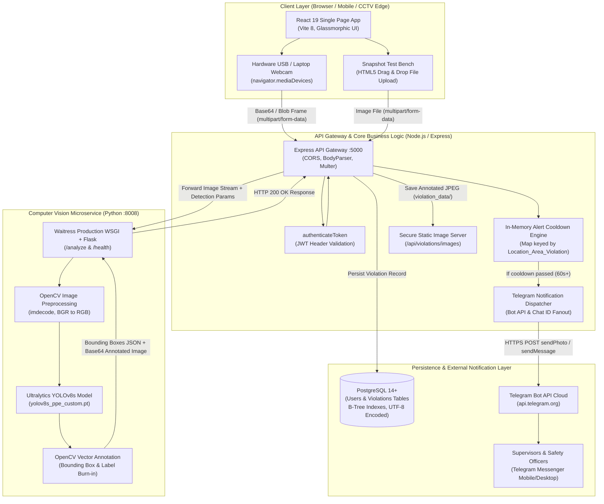
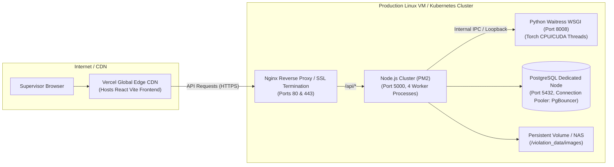
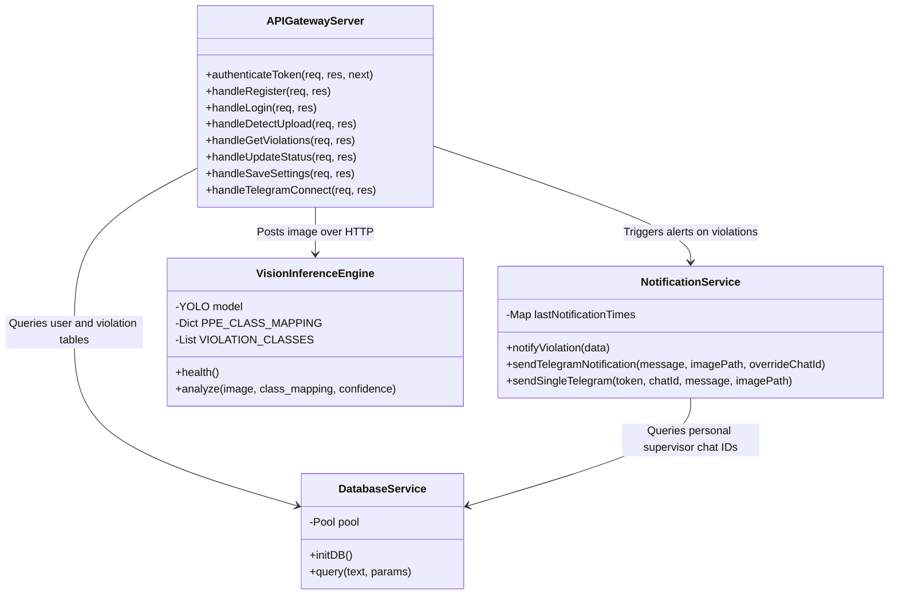
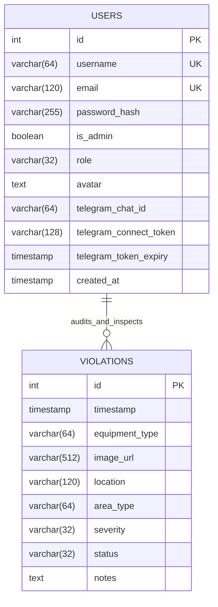
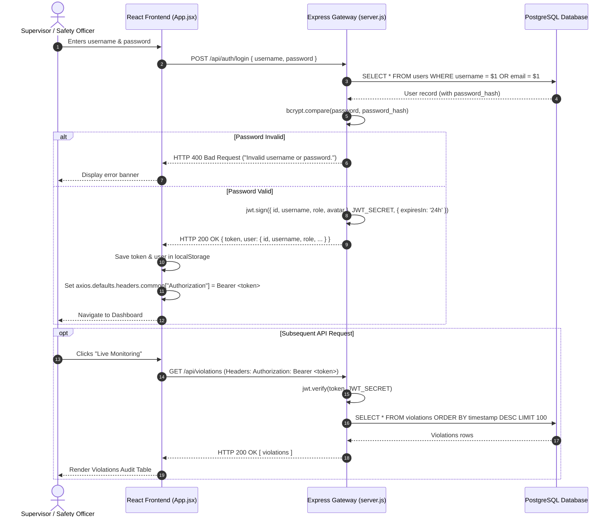
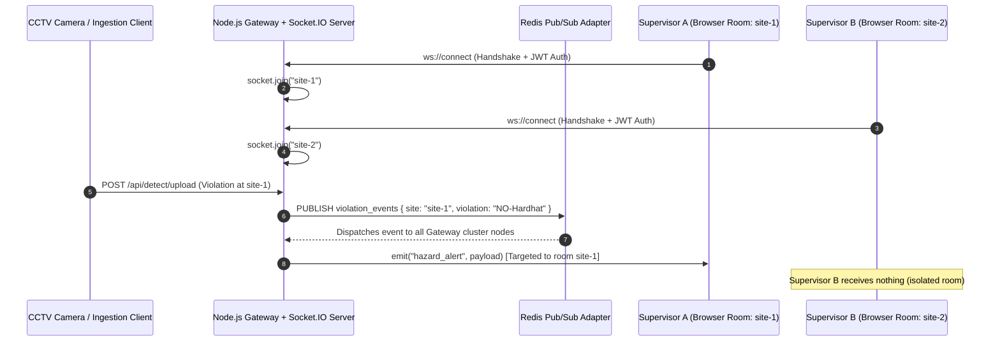
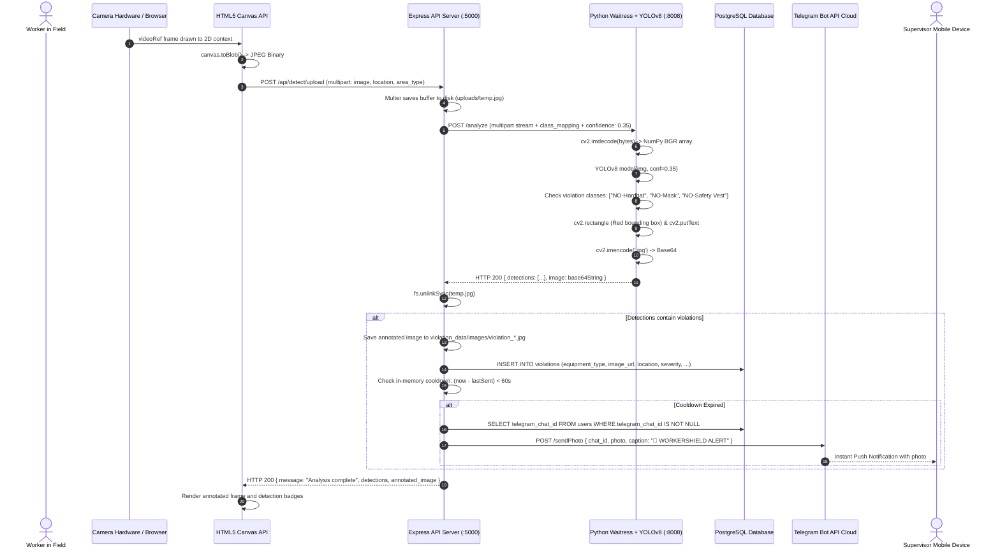
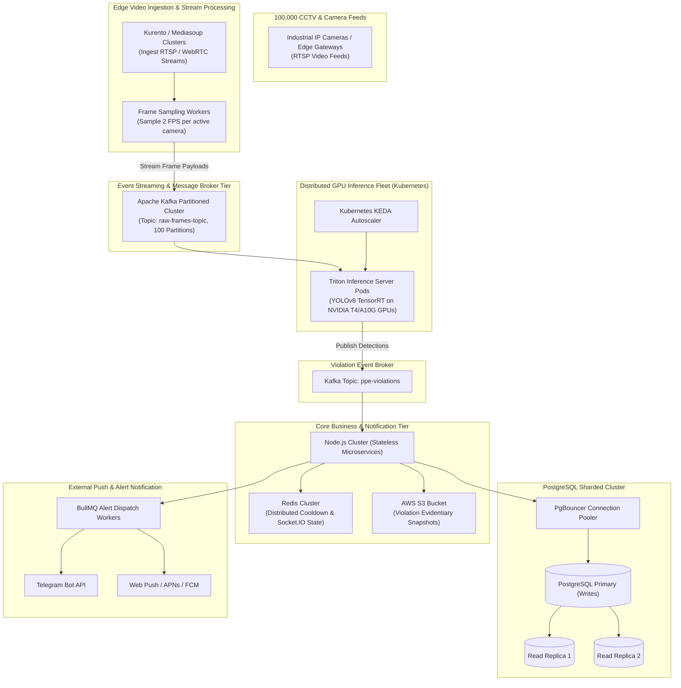

# 🛡️ WorkerShield AI — Comprehensive Software Engineering Placement Interview Master Guide

> **Author & Candidate:** Vishal Agrahari ([@quantumva23](https://github.com/quantumva23) | `va203015@gmail.com`)  
> **Repository:** [Real-Time-Alert-System/WorkerSafety](https://github.com/Real-Time-Alert-System/WorkerSafety)  
> **Target Roles:** Software Development Engineer (SDE I / SDE II), Full-Stack Engineer, Backend Systems Engineer, Computer Vision / AI Systems Engineer.

---

## 📌 Codebase Grounding & Architecture Overview Note

This guide is strictly grounded in the **WorkerShield AI** codebase (`WorkerSafety`).
* **Core Domain:** Real-time industrial computer vision safety system monitoring Personal Protective Equipment (PPE) compliance (`Hardhat`, `Safety Vest`, `Mask`, `NO-Hardhat`, `NO-Safety Vest`, `NO-Mask`), auditing OSHA compliance, and dispatching instant Telegram alerts.
* **Technology Reality:** The project uses a **Polyglot Microservices Architecture** consisting of:
  1. **Frontend:** React 19 + Vite SPA (Client-side camera frame capture via `MediaStreamTrack` and `HTMLCanvasElement`, glassmorphic responsive UI, Chart.js analytics).
  2. **API Gateway / Backend:** Node.js (v18+) with Express 4, JWT authentication, `multer` multipart handling, connection-pooled PostgreSQL (`pg`), and Telegram Bot API (`node-telegram-bot-api` / HTTP Long-Polling).
  3. **AI Vision Service:** Python 3.10+ microservice running Ultralytics YOLOv8 inference, OpenCV (`cv2`), and Flask hosted via the production WSGI server **Waitress** (on port `8008`).
* **Socket.IO Clarification:** The current implementation uses an **HTTP polling & client-driven frame capture pipeline** combined with server-side Telegram bot long-polling. In Section 6 and Section 10, we explain both the actual implemented mechanism and provide the production-grade WebSocket / Socket.IO scaling blueprint expected in senior systems interviews.

---

# 1. HIGH LEVEL DESIGN (HLD)

### 1.1 Complete System Architecture Diagram



### 1.2 Component Interaction Flow

1. **Edge Frame Acquisition:** The browser accesses user media through the HTML5 `MediaDevices.getUserMedia()` API or accepts high-resolution industrial site snapshots.
2. **Gateway Ingestion:** The React app posts `multipart/form-data` containing the captured JPEG buffer, `location`, and `area_type` with an `Authorization: Bearer <JWT>` header to Node.js on `/api/detect/upload`.
3. **Microservice Delegation:** Node.js buffers the file on disk (`uploads/`), pipes it over a low-latency loopback HTTP stream to the Python vision service on port `8008`, and appends confidence parameters and label mapping.
4. **Deep Vision Inference:** Python decodes the byte array into a NumPy matrix with `cv2.imdecode`, feeds it into `YOLOv8s`, identifies safety gear bounding boxes, checks against violation lists (`NO-Hardhat`, `NO-Safety Vest`, `NO-Mask`), and paints visual overlays.
5. **State Persistence & Alert Pipeline:** Node.js filters detections where `is_violation === true`. For every violation, it writes an audit entry into PostgreSQL (`violations` table) and checks the in-memory cooldown cache. If the cooldown threshold has elapsed, it dispatches photos and markdown alerts to all registered supervisor Telegram IDs.

### 1.3 Client-Server Architecture

* **Client (Frontend):** Thin-client reactive SPA. Responsible for device stream acquisition, hardware camera enumeration, token storage in `localStorage`, client-side routing, and real-time dashboard data presentation.
* **Server 1 (Node.js Gateway):** Stateful API orchestrator. Handles authentication (bcrypt + JWT), database connection pooling, audit queries, file system persistence for evidentiary snapshots, and notification fanout.
* **Server 2 (Python Vision Engine):** Pure compute microservice. Stateless, decoupled vision processing unit optimized for tensor execution and OpenCV operations.

### 1.4 Deployment Architecture



### 1.5 Technology Stack Justification & Tradeoffs

| Technology | Role | Why Chosen | Alternatives Considered | Tradeoff Accepted |
| :--- | :--- | :--- | :--- | :--- |
| **React 19 + Vite** | Frontend SPA | Sub-second HMR, instant build times, declarative UI, rich ecosystem for data visualization (Chart.js, Lucide). | Next.js, Vue.js, Angular | Client-side rendering (CSR) requires initial JS bundle download; accepted because WorkerShield is an authenticated internal enterprise portal, not a public SEO blog. |
| **Node.js + Express** | API Gateway & Orchestrator | Asynchronous non-blocking I/O ideal for proxying image streams, handling concurrent API requests, and managing external Webhooks/Telegram bots. | Python Django, Go, Spring Boot | Node.js is single-threaded for CPU tasks; addressed by delegating all heavy CV matrix calculations to the Python microservice. |
| **Python + Waitress** | AI Inference Microservice | Python is the de-facto ecosystem for PyTorch, OpenCV, and Ultralytics YOLO. Waitress provides a multi-threaded, battle-tested WSGI server on Windows and Linux without complex setup. | FastAPI + Uvicorn, Flask development server | FastAPI has native async, but Waitress with Flask was selected for deterministic thread management and robust Windows/Linux cross-compatibility. |
| **Ultralytics YOLOv8s** | Object Detection Engine | State-of-the-art balance between mean Average Precision (mAP) and inference latency (<200ms on CPU, <20ms on GPU). | YOLOv5, Faster R-CNN, SSD MobileNet | Faster R-CNN has higher accuracy but latency is too slow for real-time video frames (>400ms); MobileNet is faster but misses smaller PPE objects like earplugs and dust masks. |
| **PostgreSQL** | Relational Database | Strict ACID compliance, reliable foreign keys, B-Tree indexing on temporal columns, rock-solid stability for legal OSHA regulatory audits. | MongoDB, MySQL, SQLite | PostgreSQL requires rigid schema definitions and migrations compared to NoSQL, but workplace safety audits demand strict relational integrity. |
| **Telegram Bot API** | Alert Delivery | Instant push notifications on iOS, Android, and Desktop with zero SMS costs, rich Markdown formatting, and native media attachment capabilities. | Twilio WhatsApp, SendGrid, Firebase Cloud Messaging | Requires supervisors to have the Telegram app installed, but avoids per-message SMS costs ($0.05/SMS) and carrier spam filtering. |

---

# 2. LOW LEVEL DESIGN (LLD)

### 2.1 Module-Wise Breakdown

```text
WorkerSafety/
├── backend/
│   ├── server.js              # Central Express server, routes, JWT auth, and detection orchestrator
│   ├── database.js            # PostgreSQL connection pool, schema bootstrapper, indexes, seeding
│   ├── notificationService.js # In-memory per-violation alert cooldown, multi-recipient Telegram notification fanout
│   └── package.json           # Backend dependencies and scripts
├── ai_service/
│   ├── app.py                 # Flask/Waitress inference server, YOLO model loader, OpenCV renderer
│   └── models/                # Trained YOLO weights (yolov8s_ppe_custom.pt)
├── frontend/
│   ├── src/
│   │   ├── App.jsx            # Authentication state, RBAC routing, navigation shell
│   │   ├── config.js          # Dynamic environment configuration (VITE_API_URL)
│   │   ├── index.css          # Industrial dark glassmorphism design system
│   │   ├── components/
│   │   │   ├── DashboardView.jsx        # Real-time metrics, auto-refreshing Chart.js trends
│   │   │   ├── LiveMonitoringView.jsx   # Hardware camera stream, canvas capture, manual audit modal
│   │   │   ├── SubViews.jsx             # Sites/Cameras, Alerts/Incidents, Analytics, Reports, Settings
│   │   │   ├── LandingPage.jsx          # Public showcase, feature highlights, auth modal trigger
│   │   │   ├── LoginCard.jsx            # Password login & Google OAuth simulation
│   │   │   ├── RegisterCard.jsx         # User registration with RBAC role selection
│   │   │   ├── GuidelinesKnowledgeCenter.jsx # Interactive safety guidelines & OSHA standards
│   │   │   └── AboutHowItWorks.jsx      # Architecture walkthrough and technical explanation
```

### 2.2 Directory Structure & Architectural Boundaries

* **Gateway Boundary (`backend/server.js`):** Contains the HTTP interface. No computer vision logic resides here. It validates HTTP requests, checks JWT authentication, handles multipart disk storage, delegates to the AI service, coordinates database transactions, and triggers notifications.
* **Data Access Boundary (`backend/database.js`):** Encapsulates the `pg.Pool` instance. Exposes a unified `query(text, params)` helper. Runs schema creation DDL and column migrations automatically upon boot.
* **Notification Boundary (`backend/notificationService.js`):** Isolates the alert mechanism. Decouples alert formatting, Telegram REST communication, and per-violation cooldown management from the HTTP request-response cycle.
* **AI Service Boundary (`ai_service/app.py`):** Completely independent from the Node.js backend. Can be run in an isolated Docker container or a dedicated GPU instance. Only accepts an image buffer over HTTP and returns bounding boxes, labels, confidence scores, and an annotated image.

### 2.3 Component Relationships & Interactions



### 2.4 Service Layer & Controller Design

1. **Authentication Controller:**
   * `POST /api/auth/register`: Validates uniqueness of `username` and `email`. Hashes password with bcrypt (salt rounds = 10). Persists user with role (`manager`, `supervisor`, `worker`).
   * `POST /api/auth/login`: Verifies user identity, validates password hash with `bcrypt.compare`, and issues a signed HS256 JWT valid for 24 hours.
   * `POST /api/auth/google-login`: Validates `@gmail.com` domain, performs Just-In-Time (JIT) provisioning for new accounts, and issues a JWT.
2. **Inference & Detection Controller:**
   * `POST /api/detect/upload`: Uses Multer disk storage to buffer files in `backend/uploads/`. Creates a multipart stream via `form-data` and forwards it to the Python endpoint `http://127.0.0.1:8008/analyze`. Cleans up temporary upload files via `fs.unlinkSync` inside a `finally` block to prevent disk saturation.
3. **Audit & Incident Controller:**
   * `GET /api/violations`: Dynamically constructs parameterized SQL queries supporting filtering by `location`, `status`, and `severity` with pagination (`LIMIT`, `OFFSET`).
   * `POST /api/violations/:id/status`: Updates resolution status (`unresolved`, `investigating`, `resolved`).
   * `POST /api/violations/:id/notes`: Appends supervisor inspection findings.
4. **Analytics & Aggregation Controller:**
   * `GET /api/analytics/realtime`: Executes parallel SQL aggregate queries computing site hotspots, PPE item distributions, resolution rates, and supervisor response metrics.

### 2.5 Middleware Architecture

* **CORS Middleware (`cors()`):** Enables Cross-Origin Resource Sharing for decoupled local development (`localhost:5173` to `localhost:5000`) and production cloud origins.
* **JSON Body Parser (`express.json()`):** Parses JSON payloads with payload size protection.
* **Multer Middleware (`upload.single("image")`):** Intercepts multipart HTTP requests, enforces storage destination paths, and generates collision-resistant filenames (`Date.now() + "_" + file.originalname`).
* **Authentication Interceptor (`authenticateToken`):**
  ```javascript
  function authenticateToken(req, res, next) {
    const authHeader = req.headers["authorization"];
    const token = authHeader && authHeader.split(" ")[1];
    if (!token) return res.status(401).json({ error: "Access token missing." });

    jwt.verify(token, JWT_SECRET, (err, user) => {
      if (err) return res.status(403).json({ error: "Invalid or expired token." });
      req.user = user;
      next();
    });
  }
  ```
* **Static Asset Middleware (`express.static(VIOLATIONS_DIR)`):** Protected by `authenticateToken` to ensure only authenticated supervisors can access violation snapshot imagery.
* **Global 404 Catch-All Middleware:** Returns structured JSON (`{ error: "Route not found." }`) instead of standard Express HTML, preventing browser Content Security Policy (CSP) errors.

---

# 3. DATABASE DESIGN

### 3.1 Entity Relationship Diagram (ERD)



### 3.2 Complete Schema & Table Definitions

```sql
-- 1. Users Table (Personnel, Supervisors, System Administrators)
CREATE TABLE IF NOT EXISTS users (
    id SERIAL PRIMARY KEY,
    username VARCHAR(64) UNIQUE NOT NULL,
    email VARCHAR(120) UNIQUE NOT NULL,
    password_hash VARCHAR(255) NOT NULL,
    is_admin BOOLEAN DEFAULT FALSE NOT NULL,
    role VARCHAR(32) DEFAULT 'supervisor' NOT NULL,
    avatar TEXT,
    telegram_chat_id VARCHAR(64),
    telegram_connect_token VARCHAR(128),
    telegram_token_expiry TIMESTAMP,
    created_at TIMESTAMP DEFAULT CURRENT_TIMESTAMP NOT NULL
);

-- 2. Violations Table (Auditable OSHA Safety Incidents)
CREATE TABLE IF NOT EXISTS violations (
    id SERIAL PRIMARY KEY,
    timestamp TIMESTAMP DEFAULT CURRENT_TIMESTAMP NOT NULL,
    equipment_type VARCHAR(64) NOT NULL,
    image_url VARCHAR(512),
    location VARCHAR(120),
    area_type VARCHAR(64),
    severity VARCHAR(32),
    status VARCHAR(32) DEFAULT 'unresolved' NOT NULL,
    notes TEXT
);

-- 3. B-Tree Performance Indexes
CREATE INDEX IF NOT EXISTS idx_violations_timestamp ON violations (timestamp);
CREATE INDEX IF NOT EXISTS idx_violations_equipment ON violations (equipment_type);
CREATE INDEX IF NOT EXISTS idx_violations_location ON violations (location);
CREATE INDEX IF NOT EXISTS idx_violations_status ON violations (status);
```

### 3.3 Detailed Field-by-Field Breakdown

#### `users` Table
| Column Name | Data Type | Constraints | Purpose & Description |
| :--- | :--- | :--- | :--- |
| `id` | `SERIAL` | `PRIMARY KEY` | Auto-incrementing unique identifier for personnel accounts. |
| `username` | `VARCHAR(64)` | `UNIQUE, NOT NULL` | Login identifier chosen by supervisor or generated from email. |
| `email` | `VARCHAR(120)` | `UNIQUE, NOT NULL` | Verified communication email; checked during Google login. |
| `password_hash` | `VARCHAR(255)` | `NOT NULL` | Bcrypt one-way salted hash (10 salt rounds). Plaintext is never stored. |
| `is_admin` | `BOOLEAN` | `DEFAULT FALSE, NOT NULL` | Legacy administrative flag for backward compatibility. |
| `role` | `VARCHAR(32)` | `DEFAULT 'supervisor', NOT NULL` | RBAC role: `manager` (full access), `supervisor` (monitoring + audit), `worker` (read-only dashboard). |
| `avatar` | `TEXT` | `NULLABLE` | Base64-encoded user image avatar or emoji identifier. |
| `telegram_chat_id` | `VARCHAR(64)` | `NULLABLE` | Verified Telegram chat ID where direct alerts are dispatched. |
| `telegram_connect_token`| `VARCHAR(128)` | `NULLABLE` | Cryptographically secure hex token (32 chars) for Telegram account linking. |
| `telegram_token_expiry`| `TIMESTAMP` | `NULLABLE` | Token expiration timestamp (15-minute Time-To-Live). |
| `created_at` | `TIMESTAMP` | `DEFAULT CURRENT_TIMESTAMP` | Account creation timestamp. |

#### `violations` Table
| Column Name | Data Type | Constraints | Purpose & Description |
| :--- | :--- | :--- | :--- |
| `id` | `SERIAL` | `PRIMARY KEY` | Unique ID for each logged safety violation incident. |
| `timestamp` | `TIMESTAMP` | `DEFAULT CURRENT_TIMESTAMP`| UTC creation time of the violation incident. |
| `equipment_type` | `VARCHAR(64)` | `NOT NULL` | Detected non-compliant safety item (e.g., `NO-Hardhat`, `NO-Safety Vest`, `NO-Mask`). |
| `image_url` | `VARCHAR(512)` | `NULLABLE` | Relative path to annotated snapshot stored on disk (`violation_...jpg`). |
| `location` | `VARCHAR(120)` | `NULLABLE` | Physical work location (e.g., `Sector 4 Building`, `Basement Excavation Zone`). |
| `area_type` | `VARCHAR(64)` | `NULLABLE` | Specific zone category (e.g., `Scaffold Zone`, `Entrance Gate`). |
| `severity` | `VARCHAR(32)` | `NULLABLE` | Hazard level: `high` (missing hardhat), `medium` (missing vest), `low`. |
| `status` | `VARCHAR(32)` | `DEFAULT 'unresolved'` | Workflow resolution state: `unresolved`, `investigating`, or `resolved`. |
| `notes` | `TEXT` | `NULLABLE` | Detailed notes entered by supervisor during safety inspection audits. |

### 3.4 Indexes, Query Optimization & UTF-8 Encoding Safeguards

* **Timestamp Indexing (`idx_violations_timestamp`):** The dashboard renders 30-day incident frequency trends via `WHERE timestamp >= NOW() - INTERVAL '30 days'`. Without this B-Tree index, PostgreSQL would perform an $O(N)$ sequential table scan on every dashboard poll. With the index, lookup complexity is $O(\log N)$.
* **Location & Equipment Indexes (`idx_violations_location`, `idx_violations_equipment`):** Optimizes `GROUP BY location` and `GROUP BY equipment_type` operations for the analytics hotspot aggregation queries.
* **UTF-8 Guard:**
  ```javascript
  pool.on("connect", (client) => {
    client.query("SET client_encoding = 'UTF8';").catch(() => {});
  });
  ```
  Industrial sites often use non-ASCII symbols, accented characters, or localized site names. Enforcing `UTF-8` on every connection avoids query execution failures and database corruption.

---

# 4. AUTHENTICATION & AUTHORIZATION FLOW

### 4.1 Sequence Diagram: Login & Protected Access



### 4.2 User Signup Flow
1. User provides `username`, `email`, `password`, and selects a `role` (`manager`, `supervisor`, `worker`).
2. Gateway verifies all fields are populated and executes a duplicate check query:
   `SELECT id FROM users WHERE username = $1 OR email = $2;`
3. Password is salt-hashed using `bcrypt.hash(password, 10)` to prevent rainbow table attacks.
4. User record is inserted into PostgreSQL and returns an initial user object without exposing the password hash.

### 4.3 Google OAuth Onboarding Flow
1. User enters their `@gmail.com` address.
2. The endpoint `POST /api/auth/google-login` validates that the string ends with `@gmail.com`.
3. It performs a lookup in PostgreSQL:
   * **Existing User:** Generates a JWT token immediately.
   * **New User:** Automatically creates a new record in the database with role `manager` and a placeholder hashed password, onboarding them in a single step.
4. Returns a standard signed JWT for application access.

### 4.4 Role-Based Access Control (RBAC) Matrix

| User Role | Dashboard | Live Monitoring | Sites & Cameras | Alerts & Incidents | Analytics | Reports | Settings |
| :--- | :---: | :---: | :---: | :---: | :---: | :---: | :---: |
| **Manager** | ✅ | ✅ | ✅ | ✅ | ✅ | ✅ | ✅ |
| **Supervisor** | ✅ | ✅ | ❌ | ✅ | ✅ | ✅ | ✅ |
| **Worker** | ✅ | ❌ | ❌ | ❌ | ❌ | ❌ | ❌ |

Access control is enforced on the frontend in `App.jsx` using `canAccessPage(pageName, user)` and on the backend via user role validation on administrative endpoints.

---

# 5. REAL-TIME COMMUNICATION & SOCKET.IO ARCHITECTURE

### 5.1 Codebase Reality Check: Current Implementation
In the current repository:
* **Frame Ingestion:** The client captures frames at a configurable sampling rate from `HTMLVideoElement` onto an offscreen `HTMLCanvasElement`, converts them to a JPEG Blob, and transmits them via standard HTTP POST (`/api/detect/upload`).
* **Dashboard Metric Synchronization:** The frontend invokes `loadData()` inside a recurring `setInterval` loop (polling every 4,000 milliseconds) to fetch fresh stats and recent violations.
* **Telegram Bot Updates:** The backend uses `node-telegram-bot-api` configured in long-polling mode (`{ polling: true }`) to listen for Telegram server updates without requiring public incoming webhook URLs during local development.

### 5.2 How Multiple Supervisors Coordinate (Current System)
* When a violation occurs, the system logs the incident with `status: 'unresolved'`.
* Multiple supervisors viewing the dashboard receive the latest state on their next 4-second polling cycle.
* When a supervisor updates the status to `investigating` or `resolved` via `POST /api/violations/:id/status`, the record is updated in PostgreSQL.
* Concurrent edits to incident notes use an "atomic update" pattern: the latest HTTP POST commits its text to PostgreSQL, and subsequent polling calls synchronize all active client dashboards.

### 5.3 Scaling Real-Time: Production WebSocket / Socket.IO Integration Blueprint

To eliminate 4-second polling latency and scale to thousands of connected clients, Socket.IO can be integrated as follows:



#### Production Implementation Blueprint
1. **Connection Lifecycle & Authentication:**
   * Supervisor client initiates WebSocket handshake: `io("https://api.workershield.ai", { auth: { token } })`.
   * Gateway validates the JWT inside `io.use((socket, next) => { ... })`. If invalid or expired, the socket connection is rejected immediately.
2. **Room Management:**
   * Clients join rooms matching their physical site: `socket.join(user.assigned_site_id)`.
   * Enables targeted alerts: only safety personnel responsible for "Building Sector 4" receive real-time push events for that zone, reducing unnecessary notification traffic.
3. **Horizontal Scalability with Redis Adapter:**
   * Multiple Node.js gateway instances run behind an Nginx load balancer with sticky sessions.
   * `socket.io-redis` adapter synchronizes broadcasts across cluster nodes via Redis Pub/Sub channels.

---

# 6. COMPLETE END-TO-END REQUEST FLOWS

### 6.1 Feature 1: Live Hardware Video Frame Capture & YOLOv8 Inference Relay



* **Frontend Flow:** `LiveMonitoringView.jsx` gets video stream tracks via `getUserMedia`. The user clicks "Capture & Analyze Live Frame" (or triggers automatic frame polling). The active frame is painted onto an offscreen canvas, converted into a high-quality JPEG Blob, and submitted using `axios.post` with a multipart `FormData` payload.
* **Backend Flow:** `server.js` stores the incoming image via Multer into `backend/uploads/`. It opens a readable stream with `fs.createReadStream` and forwards it to the Python AI service via an Axios POST request.
* **AI Service Flow:** `app.py` parses the byte stream with OpenCV, runs the PyTorch tensor forward pass using `model(img, conf=0.35)`, iterates through the bounding boxes, draws red bounding rectangles for non-compliant equipment, converts the image into Base64 format, and returns the detection results.
* **Database & Notification Flow:** Node.js writes each detected violation into the `violations` table, updates the alert cooldown timer, and pushes photos and alert text to all subscribed supervisor Telegram accounts.

---

### 6.2 Feature 2: Automated Cooldown Engine & Multi-Target Alert Dispatch
* **Problem:** A video stream runs at 15–30 frames per second. If a worker stands without a hardhat for 10 seconds, the AI service will detect ~200 violations. Dispatching 200 Telegram alerts would flood the supervisor's phone and trigger Telegram API rate limits (HTTP 429 Too Many Requests).
* **Implementation:** `notificationService.js` maintains an in-memory key-value cache:
  ```javascript
  const lastNotificationTimes = new Map();
  const cooldownKey = `${location}_${areaType}_${violationType}`;
  const lastSent = lastNotificationTimes.get(cooldownKey);
  if (lastSent && (now - lastSent) < cooldownPeriod) {
    return false; // Skip duplicate alert
  }
  ```
* **Fanout Logic:** Alerts are dispatched to:
  1. The central group channel specified by `process.env.TELEGRAM_CHAT_ID`.
  2. All individual supervisor chat IDs queried dynamically from `SELECT telegram_chat_id FROM users`.

---

### 6.3 Feature 3: Telegram Account Linking via Deep Links (`/start <token>`)

```mermaid
sequenceDiagram
    autonumber
    actor Sup as Supervisor User
    participant Browser as WorkerShield Dashboard (Settings)
    participant Gateway as Express Gateway (:5000)
    participant DB as PostgreSQL Database
    participant Bot as Telegram Bot Instance (Long-Polling)
    participant TGCloud as Telegram Cloud Servers

    Sup->>Browser: Clicks "Connect My Telegram"
    Browser->>Gateway: POST /api/telegram/connect (Auth: Bearer JWT)
    Gateway->>TGCloud: GET /getMe (Validate Bot Token & fetch bot username)
    Gateway->>Gateway: crypto.randomBytes(16).toString('hex') -> connectToken
    Gateway->>Gateway: expiryTime = NOW() + 15 minutes
    Gateway->>DB: UPDATE users SET telegram_connect_token = $1, telegram_token_expiry = $2 WHERE id = $3;
    Gateway-->>Browser: HTTP 200 { deepLink: "https://t.me/WorkerShieldBot?start=3f8a...", connectToken }
    Browser->>Browser: Opens deep link in new tab + starts polling /api/telegram/status every 3s

    Sup->>TGCloud: Opens Telegram app, clicks START (/start 3f8a...)
    TGCloud-->>Bot: Incoming message update (/start 3f8a...)
    Bot->>DB: SELECT id, username FROM users WHERE telegram_connect_token = $1 AND telegram_token_expiry > NOW();
    DB-->>Bot: Returns matching user record
    Bot->>DB: UPDATE users SET telegram_chat_id = $1, telegram_connect_token = NULL WHERE id = $2;
    Bot->>TGCloud: sendMessage(chatId, "✅ Successfully connected to WorkerShield!")
    TGCloud-->>Sup: Confirmation message received in Telegram chat

    Browser->>Gateway: GET /api/telegram/status (next 3-second poll)
    Gateway->>DB: SELECT telegram_chat_id FROM users WHERE id = $1;
    Gateway-->>Browser: HTTP 200 { connected: true, personalId: "1613628414" }
    Browser->>Browser: Stops polling; UI displays green "Connected" badge
```

---

### 6.4 Feature 4: Incident Status & Supervisor Audit Trail
1. A supervisor spots an unresolved violation in the **Alerts & Incidents** view.
2. Clicking **Inspect** opens the modal in `LiveMonitoringView.jsx`, displaying the full-resolution violation photo served securely through `/api/violations/images/:filename`.
3. The supervisor enters inspection notes (e.g., *"Worker issued replacement hardhat on site"*) and changes the status from `unresolved` to `resolved`.
4. The client dispatches two requests:
   * `POST /api/violations/:id/status` with `{ status: "resolved" }`
   * `POST /api/violations/:id/notes` with `{ notes: "Worker issued replacement..." }`
5. The gateway updates the database record. The next analytics refresh cycle automatically recalculates the site's resolution rate percentage.

---

### 6.5 Note on Prompt's Template Features
> **Interview Readiness Note:** If an interviewer asks: *"Does this application analyze source code, track cyclomatic complexity, or provide multi-user collaborative code rooms?"*  
> **Candidate Answer:** *"No. WorkerShield AI is dedicated to industrial workplace safety and real-time computer vision monitoring. However, its architectural patterns—such as microservice boundaries, asynchronous processing pipelines, rate-limiting engines, and multi-user audit workflows—apply directly to high-throughput software systems and collaborative applications."*

---

# 7. COMPLETE API SPECIFICATION

All endpoints (except login/register) require the HTTP header:  
`Authorization: Bearer <JWT_TOKEN>`

| Endpoint | Method | Auth Req. | Request Body / Params | Response Body Summary | Status Codes |
| :--- | :--- | :---: | :--- | :--- | :--- |
| `/api/auth/register` | `POST` | ❌ No | `{ username, email, password, role, avatar }` | `{ message, user: { id, username, email, role } }` | `201`, `400`, `500` |
| `/api/auth/login` | `POST` | ❌ No | `{ username, password }` | `{ message, token, user }` | `200`, `400`, `500` |
| `/api/auth/google-login` | `POST` | ❌ No | `{ email, username }` | `{ message, token, user }` | `200`, `400`, `500` |
| `/api/auth/me` | `GET` | ✅ Yes | *None* | `{ user: { id, username, email, role, avatar } }` | `200`, `401`, `404` |
| `/api/auth/profile` | `POST` | ✅ Yes | `{ username, email, avatar }` | `{ message, token, user }` | `200`, `400`, `500` |
| `/api/detect/upload` | `POST` | ✅ Yes | Multipart: `image` (file), `location`, `area_type` | `{ message, detections, violations_count, annotated_image, saved_image }` | `200`, `400`, `500` |
| `/api/violations` | `GET` | ✅ Yes | Query: `?location=&status=&severity=&limit=100&offset=0` | `[ { id, timestamp, equipment_type, image_url, location, severity, status, notes } ]` | `200`, `401`, `500` |
| `/api/violations/:id/status` | `POST` | ✅ Yes | URL Param: `id`, Body: `{ status: "resolved" }` | `{ message, violation }` | `200`, `400`, `404` |
| `/api/violations/:id/notes` | `POST` | ✅ Yes | URL Param: `id`, Body: `{ notes: "Inspected on site" }` | `{ message, violation }` | `200`, `400`, `404` |
| `/api/violations/images/:file`| `GET` | ✅ Yes | URL Param: `file` | Image binary (`image/jpeg`) | `200`, `401`, `404` |
| `/api/dashboard/stats` | `GET` | ✅ Yes | *None* | `{ by_equipment, by_severity, by_location, by_status, daily_trend }` | `200`, `401`, `500` |
| `/api/analytics/realtime` | `GET` | ✅ Yes | *None* | `{ totalViolations, totalResolved, resolutionRate, hotspots, equipmentBreakdown, supervisors }` | `200`, `401`, `500` |
| `/api/reports/summary` | `GET` | ✅ Yes | *None* | `{ totalIncidents, unresolvedIncidents, bySeverity, latestIncidents }` | `200`, `401`, `500` |
| `/api/settings` | `GET` | ✅ Yes | *None* | `{ telegramEnabled, telegramBotToken, telegramChatId, notificationCooldown }` | `200`, `401`, `500` |
| `/api/settings` | `POST` | ✅ Yes | `{ telegramEnabled, telegramBotToken, telegramChatId, notificationCooldown }` | `{ message: "Settings saved successfully to .env and re-applied." }` | `200`, `401`, `500` |
| `/api/settings/test-telegram`| `POST` | ✅ Yes | *None* | `{ message: "Test alert dispatched to Telegram successfully!" }` | `200`, `400`, `401` |
| `/api/telegram/connect` | `POST` | ✅ Yes | *None* | `{ deepLink, connectToken, botUsername, expiresAt }` | `200`, `400`, `500` |
| `/api/telegram/status` | `GET` | ✅ Yes | *None* | `{ connected: boolean, personalId: string, pending: boolean }` | `200`, `401`, `404` |
| `/api/telegram/connect` | `DELETE`| ✅ Yes | *None* | `{ message: "Telegram personal connection removed successfully." }` | `200`, `401`, `500` |

---

# 8. TECHNICAL INTERVIEW QUESTIONS & ANSWERS (60 QUESTIONS)

## 🔰 Beginner Level (20 Questions)

#### Q1: What is the primary purpose of WorkerShield AI?
**Answer:** WorkerShield AI is a real-time computer vision safety platform designed for industrial worksites. It monitors live video feeds and uploaded snapshots to detect PPE non-compliance (missing hardhats, safety vests, and masks), logs audit records into PostgreSQL, and sends instant photo alerts to safety supervisors via Telegram.

#### Q2: What is the core microservices architecture of the system?
**Answer:** The system consists of three main tiers: a React 19 single-page frontend, a Node.js Express API gateway managing authentication, persistence, and notifications, and an independent Python service running Ultralytics YOLOv8 for AI vision inference.

#### Q3: Why did you choose React with Vite instead of Create React App (CRA)?
**Answer:** CRA is deprecated and relies on slow Webpack bundling. Vite uses native ES modules (ESM) during development and Rollup for production builds, providing near-instant Hot Module Replacement (HMR) and significantly faster build times.

#### Q4: How is authentication managed across client requests?
**Answer:** The system uses JSON Web Tokens (JWT). Upon successful login, the server signs a token containing the user's ID, username, and role. The client stores this in `localStorage` and attaches it to every subsequent request using an `Authorization: Bearer <token>` HTTP header.

#### Q5: How do passwords get stored securely in the database?
**Answer:** Passwords are never stored in plaintext. They are hashed using `bcryptjs` with 10 salt rounds before being written to PostgreSQL. During login, `bcrypt.compare` verifies the hash against the submitted password.

#### Q6: How does the application capture video from physical cameras?
**Answer:** The frontend uses the browser's standard `navigator.mediaDevices.getUserMedia()` API to request a video stream from connected laptop webcams, USB cameras, or phone cameras.

#### Q7: How does an HTML5 video frame get sent to the backend?
**Answer:** In `LiveMonitoringView.jsx`, an offscreen `<canvas>` captures the current frame using `context.drawImage()`. It converts the canvas contents to a binary JPEG Blob using `canvas.toBlob()`, attaches it to a `FormData` object, and sends it to the backend via an Axios HTTP POST request.

#### Q8: What library performs the object detection in the AI service?
**Answer:** Ultralytics YOLOv8 (specifically `yolov8s_ppe_custom.pt`), which performs single-pass object detection and classification in under 200ms on CPU.

#### Q9: What classes does the custom YOLOv8 model detect?
**Answer:** Classes include: `person`, `Hardhat`, `Mask`, `NO-Hardhat`, `NO-Mask`, `NO-Safety Vest`, `Safety Cone`, `Safety Vest`, `machinery`, and `vehicle`.

#### Q10: How does the system determine whether a detection is a violation?
**Answer:** The AI service parses the environment variable `VIOLATION_CLASSES` (default: `["NO-Hardhat", "NO-Mask", "NO-Safety Vest"]`). If a detected bounding box label matches any entry in this array, `is_violation` is set to `true`.

#### Q11: How does OpenCV annotate violation frames?
**Answer:** OpenCV uses `cv2.rectangle()` to draw bounding boxes around detected objects (red for violations, green for compliant gear) and `cv2.putText()` to overlay the class label and confidence score.

#### Q12: Why is the AI service written in Python while the gateway is in Node.js?
**Answer:** Python is the standard language for machine learning, with first-class support for PyTorch, Ultralytics, and OpenCV. Node.js is well-suited for I/O-heavy operations like handling API requests, managing database queries, and dispatching notifications.

#### Q13: What database does WorkerShield AI use, and why?
**Answer:** PostgreSQL. It provides ACID compliance, structured schemas, relational integrity, and B-Tree indexing, which are essential for legal OSHA compliance audits.

#### Q14: How are violation snapshots stored and retrieved?
**Answer:** Annotated images are saved to disk under `violation_data/images/` using a unique filename. The relative path is stored in the `violations.image_url` database column. The file is served via the authenticated static route `/api/violations/images/:filename`.

#### Q15: What is the purpose of the notification cooldown?
**Answer:** Video feeds process multiple frames per second. Without a cooldown, a worker without a hardhat would trigger dozens of alerts per second. The cooldown limits notifications to once every 60 seconds per location, area, and violation type.

#### Q16: How does the supervisor link their personal Telegram account?
**Answer:** The system generates a deep link containing a 15-minute cryptographic token (`https://t.me/<bot>?start=<token>`). When the supervisor taps the link in Telegram, the bot reads the token via long polling, matches it to the user in PostgreSQL, and saves their Telegram `chat_id`.

#### Q17: What does the `authenticateToken` middleware do if a token is missing?
**Answer:** It checks the `Authorization` header. If the header or token is missing, it terminates the request immediately and returns HTTP `401 Unauthorized`. If the token is invalid or expired, it returns HTTP `403 Forbidden`.

#### Q18: What is Role-Based Access Control (RBAC) in this application?
**Answer:** The system supports three roles: `manager`, `supervisor`, and `worker`. Managers have full access, supervisors can view streams and resolve alerts, and workers have read-only access to the safety dashboard.

#### Q19: What is the purpose of the `initDB` function in `database.js`?
**Answer:** It bootstraps the PostgreSQL database on server startup. It connects to the default `postgres` database, creates the `worker_safety` database if it doesn't exist, builds the tables and indexes, and seeds a default admin account if the user table is empty.

#### Q20: What is CORS, and why is it needed in this project?
**Answer:** Cross-Origin Resource Sharing (CORS) is a browser security mechanism that restricts HTTP requests to different domains, ports, or protocols. It is enabled in Express using `cors()` so the Vite frontend (port 5173) can communicate with the Express API (port 5000).

---

## ⚙️ Intermediate Level (20 Questions)

#### Q21: Explain the lifecycle of an uploaded image from receipt to deletion.
**Answer:** The image is received by Express via `multer.diskStorage` and written to `backend/uploads/`. Node.js pipes the file stream to Python via Axios. Python decodes the image in memory and runs YOLO inference. Once Python responds, Node.js deletes the temporary upload file using `fs.unlinkSync()`. If a violation is detected, the annotated Base64 image is written to `violation_data/images/` for long-term storage.

#### Q22: Why did you implement connection pooling with `pg.Pool` instead of individual client connections?
**Answer:** Opening and closing a new TCP connection and performing the PostgreSQL SSL/auth handshake for every HTTP request adds 20–50ms of latency per query. A connection pool maintains an active set of reusable connections, reducing query latency and preventing database connection exhaustion under load.

#### Q23: How does the in-memory rate limiter handle alert deduplication?
**Answer:** `notificationService.js` maintains a JavaScript `Map`. When an alert is triggered, it constructs a composite key: `${location}_${areaType}_${violationType}`. If `(Date.now() - lastNotificationTimes.get(key)) < cooldownPeriod`, the alert is skipped. Otherwise, the alert is sent and the current timestamp is recorded in the map.

#### Q24: What is the limitation of storing the alert cooldown in a JavaScript `Map`?
**Answer:** The in-memory map is local to a single Node.js process. If the server restarts, all cooldown state is lost. If the backend is scaled horizontally across multiple instances behind a load balancer, each instance maintains its own map, which could lead to duplicate alerts. In production, this should be replaced with Redis keys using TTL expiration.

#### Q25: How does the `/api/analytics/realtime` endpoint aggregate hazard hotspots?
**Answer:** It executes a SQL aggregation query:
```sql
SELECT location, COUNT(*) as count,
       SUM(CASE WHEN status = 'resolved' THEN 1 ELSE 0 END) as resolved_count,
       SUM(CASE WHEN severity = 'high' THEN 1 ELSE 0 END) as high_severity_count
FROM violations GROUP BY location ORDER BY count DESC LIMIT 6;
```
This groups all logged violations by site location in a single pass, computing total incidents, resolutions, and high-severity counts.

#### Q26: Explain how the Telegram Bot runs inside the Express process without port collisions.
**Answer:** The Telegram bot uses long-polling mode (`{ polling: true }`) instead of webhooks. It initiates outbound HTTPS requests to `api.telegram.org` to poll for incoming messages, so it does not require an open inbound port or collide with Express on port 5000.

#### Q27: How does `app.post("/api/settings")` persist configuration changes?
**Answer:** It updates the in-memory `process.env` properties immediately and reads the `.env` file on disk, updates matching key-value pairs using regular expressions, and writes the updated contents back to disk using `fs.writeFileSync()`. It then re-initializes the Telegram bot instance with the new token.

#### Q28: How do you prevent SQL injection in dynamic filter queries like `/api/violations`?
**Answer:** The endpoint uses parameterized queries. Instead of concatenating user input directly into the SQL string, it appends `$1`, `$2`, etc., and places user values into a parameters array:
```javascript
queryParams.push(`%${location}%`);
queryText += ` AND location ILIKE $${queryParams.length}`;
```
PostgreSQL compiles the query plan first, treating the inputs strictly as literal values and eliminating SQL injection risks.

#### Q29: How does the system handle Just-In-Time (JIT) provisioning for Google authentication?
**Answer:** In `app.post("/api/auth/google-login")`, the server checks whether the submitted email exists in PostgreSQL. If not, it automatically creates a new record with a placeholder password hash and grants manager access, allowing immediate access without a separate registration step.

#### Q30: What is the difference between CPU and GPU inference performance for YOLOv8?
**Answer:** On modern multi-core CPUs, YOLOv8s runs inference in 120–250ms using optimized NumPy vectorization and OpenMP threading. On an NVIDIA GPU with CUDA and TensorRT acceleration, inference latency drops to 8–18ms, enabling full 30 FPS video stream processing.

#### Q31: How does the frontend handle token expiration?
**Answer:** If the JWT expires (after 24 hours), backend endpoints return HTTP `403 Forbidden`. Axios response interceptors catch this status code, remove the expired token from `localStorage`, and redirect the user to the landing page to re-authenticate.

#### Q32: Why is the AI service using Waitress instead of the default Flask development server?
**Answer:** The default Flask server (`Werkzeug`) is single-threaded, not intended for production, and handles requests sequentially. Waitress is a production-ready, multi-threaded WSGI server that handles concurrent requests efficiently and runs reliably on both Windows and Linux environments.

#### Q33: How does the application avoid storing Base64 images directly in PostgreSQL?
**Answer:** Base64-encoded strings increase data size by ~33% over binary formats. Storing large images directly in the database would lead to rapid table bloat, slow index scans, and memory pressure. Instead, the application writes images to disk as `.jpg` files and stores only the file path string in PostgreSQL.

#### Q34: What indexes exist on the `violations` table, and what is their impact?
**Answer:** Indexes exist on `timestamp`, `equipment_type`, `location`, and `status`. They allow filtering and sorting operations (e.g., `WHERE timestamp >= NOW() - INTERVAL '30 days'` and `WHERE status = 'unresolved'`) to run as index scans in $O(\log N)$ time rather than full table scans in $O(N)$ time.

#### Q35: How does the client-side camera selector work in `LiveMonitoringView.jsx`?
**Answer:** It calls `navigator.mediaDevices.enumerateDevices()`, filters devices where `device.kind === "videoinput"`, and populates a dropdown with available devices (e.g., integrated webcam, USB borescope, virtual camera). When the user selects a camera, the stream is restarted using `{ deviceId: { exact: selectedDeviceId } }`.

#### Q36: How does the application support switching between front and rear cameras on mobile devices?
**Answer:** It uses the `facingMode` constraint in `getUserMedia`. Toggling between `"user"` (front-facing) and `"environment"` (rear-facing) prompts the browser to switch camera sensors without requiring manual device ID selection.

#### Q37: How does `notificationService.js` handle Telegram API rate limits?
**Answer:** Telegram limits bots to ~30 messages per second across all chats and 1 message per second within a single chat. WorkerShield AI's 60-second cooldown per location prevents message bursts from triggering Telegram's `429 Too Many Requests` error.

#### Q38: Why is the database encoding explicitly set to `UTF8` on client connections?
**Answer:** Industrial sites often use special characters, symbols, or multilingual descriptions. If the PostgreSQL client encoding defaults to SQL_ASCII or Latin1, inserting non-ASCII characters can cause encoding errors or corrupt text in audit records.

#### Q39: What happens if the Python AI service is down when a user uploads an image?
**Answer:** The Node.js Axios call to `http://localhost:8008/analyze` fails with `ECONNREFUSED` or hits the 30-second timeout. The error is caught in `server.js`, the temporary upload file is deleted in the `finally` block, and the client receives a structured `HTTP 500 { error: "AI evaluation service failed." }` response.

#### Q40: How does the frontend prevent Chart.js memory leaks during data refreshes?
**Answer:** In `DashboardView.jsx`, active chart instances are tracked in a React `useRef` array (`activeCharts.current`). Before creating a new chart instance during a refresh cycle, it iterates over existing charts and calls `.destroy()`, releasing canvas contexts and event listeners.

---

## 🚀 Advanced Level (20 Questions)

#### Q41: How would you transition this architecture from HTTP frame sampling to real-time WebRTC ingestion?
**Answer:** Replace the canvas-based HTTP POST mechanism with a WebRTC MediaStream peer connection terminated by a media server (such as Mediasoup, Janus, or Pion). The media server decodes the incoming RTP video stream into raw I420/NV12 frames, batches frames through shared memory into a C++/Python GPU inference process running TensorRT, and pushes detection metadata back to the client over a WebRTC DataChannel in sub-100ms latency.

#### Q42: What architectural changes are needed to scale this system to 50,000 concurrent CCTV streams?
**Answer:**
1. **Edge Processing:** Run lightweight detection models (e.g., YOLOv8-Nano) directly on edge gateways or IP cameras, transmitting only violation events and keyframes to the cloud rather than full video feeds.
2. **Message Broker:** Place an Apache Kafka or AWS Kinesis cluster between the ingestion tier and inference workers to buffer incoming event streams.
3. **Inference Fleet:** Deploy inference workers across a Kubernetes cluster (EKS/GKE) using KEDA to autoscale GPU pods based on queue depth.
4. **Storage Tier:** Replace local disk storage with Amazon S3 or Google Cloud Storage fronted by CloudFront CDN.
5. **Database Partitioning:** Use PostgreSQL declarative partitioning on `violations` by year/month to keep index sizes manageable.

#### Q43: How does YOLOv8 perform single-stage object detection compared to two-stage detectors like Faster R-CNN?
**Answer:** Two-stage detectors first use a Region Proposal Network (RPN) to generate regions of interest (RoIs), then crop features and run a secondary classifier, which introduces latency (>300ms). YOLOv8 is a single-stage, anchor-free detector that predicts bounding box offsets and class probabilities directly from full feature maps across multiple scales (P3, P4, P5) in a single forward pass, making it fast enough for real-time video inference.

#### Q44: What is Non-Maximum Suppression (NMS) and why is it important in PPE detection?
**Answer:** Object detection models frequently predict multiple overlapping bounding boxes for the same physical object. Non-Maximum Suppression (NMS) sorts bounding boxes by confidence score, selects the highest-scoring box, and calculates the Intersection over Union (IoU) with neighboring boxes. Boxes with an IoU above a set threshold (e.g., 0.45) are discarded, ensuring only a single detection is returned per object.

#### Q45: How would you secure this system against Man-In-The-Middle (MITM) attacks and data tampering?
**Answer:**
1. Enforce HTTPS/TLS 1.3 across all communication channels using automated Let's Encrypt certificates.
2. Place the Python AI service inside a private Virtual Private Cloud (VPC) subnet with no public internet ingress, accepting connections only from the Node.js API Gateway.
3. Hash and sign stored violation images using SHA-256 to ensure cryptographic tamper resistance for legal OSHA audits.
4. Store JWT secrets in cloud secret management systems (e.g., AWS Secrets Manager, HashiCorp Vault) rather than `.env` text files on disk.

#### Q46: How would you handle network partitions between the industrial edge and cloud servers?
**Answer:** Deploy a local edge appliance (e.g., NVIDIA Jetson Orin) on-site. The edge device runs the YOLO inference model locally and stores events in an embedded SQLite or DuckDB instance during network outages. When the internet connection is restored, a local agent replays queued violations to the cloud API Gateway via an idempotent synchronization protocol.

#### Q47: Why is `crypto.randomBytes(16).toString("hex")` preferred over `Math.random()` for Telegram connection tokens?
**Answer:** `Math.random()` uses a pseudo-random number generator (PRNG) that is predictable and cryptographically insecure, making it vulnerable to brute-force token hijacking. `crypto.randomBytes()` queries the operating system's entropy pool (e.g., `/dev/urandom` or Windows CryptoAPI), producing a cryptographically secure token that cannot be anticipated by an attacker.

#### Q48: How would you eliminate the 15-minute token expiry race condition during Telegram account linking?
**Answer:** Set up a dedicated background worker using BullMQ and Redis to handle token expiration. When a token is issued, schedule a delayed job for 15 minutes. If linking occurs before the job runs, cancel the job. If the job fires, it invalidates the token in PostgreSQL. This replaces passive `NOW() > telegram_token_expiry` database checks with deterministic expiration events.

#### Q49: How would you optimize PostgreSQL when the `violations` table reaches 50 million rows?
**Answer:**
1. **Declarative Range Partitioning:** Partition the table by `timestamp` on a monthly basis:
   ```sql
   CREATE TABLE violations ( ... ) PARTITION BY RANGE (timestamp);
   ```
2. **Cold Data Archival:** Move partitions older than 12 months to compressed object storage (e.g., Apache Parquet on AWS S3 queried via Amazon Athena).
3. **Connection Pooling:** Introduce PgBouncer in transaction pooling mode to handle thousands of concurrent queries without thread exhaustion.
4. **Read Replicas:** Route read-heavy dashboard and analytics traffic to read replicas, reserving the primary database instance for write operations.

#### Q50: How do you prevent memory leaks when processing continuous base64-encoded video frames?
**Answer:**
1. In Python, call `cv2.imdecode` directly from raw byte buffers without creating redundant string copies.
2. Ensure OpenCV frame buffers are allocated once and reused across inferences rather than creating new matrices on every frame.
3. In Node.js, stream binary buffers directly rather than storing Base64 representations in heap memory.
4. Monitor V8 heap allocations using Node.js profiling tools (`--max-old-space-size`, heap snapshots) to verify that garbage collection cycles reclaim memory properly.

#### Q51: How would you implement distributed tracing across the React, Node.js, and Python services?
**Answer:** Integrate OpenTelemetry (OTel). The React client generates a W3C `traceparent` header on API requests. The Node.js gateway reads the header, creates a child span for its database operations, and forwards the header to the Python service. Python creates its own child span covering image decoding and YOLO inference. All traces are exported to a central backend (e.g., Jaeger, Datadog) to visualize end-to-end latency and identify bottlenecks.

#### Q52: What is the risk of using `fs.writeFileSync` inside `/api/settings` in production?
**Answer:** `fs.writeFileSync` blocks the single-threaded Node.js event loop during the disk write, delaying all concurrent requests. Additionally, in containerized environments (e.g., Docker, Kubernetes, AWS ECS), container file systems are ephemeral; changes written to a local `.env` file are lost on pod restart. In production, configuration updates should be written to a persistent database table or a dedicated configuration service.

#### Q53: How would you handle false positives where lighting or reflections mimic a missing hardhat?
**Answer:**
1. **Temporal Confirmation Window:** Require a violation to be detected across multiple consecutive frames (e.g., 4 out of 5 frames over 2 seconds) before triggering an alert, filtering out single-frame false positives.
2. **Confidence Thresholding:** Increase detection thresholds for high-consequence alerts (e.g., `conf >= 0.65`).
3. **Active Learning Pipeline:** Allow supervisors to flag false positives in the audit interface. Flagged frames are stored in an active learning pool, re-annotated, and used to fine-tune the model in subsequent training cycles.

#### Q54: How would you secure the `/api/violations/images` static image route?
**Answer:** Currently, the route uses `authenticateToken`, requiring a valid JWT header. To prevent unauthorized access:
1. Generate short-lived (e.g., 5-minute) signed URLs (HMAC tokens) for image access.
2. Ensure the file serving logic validates that requested filenames match a safe pattern (e.g., `^[a-zA-Z0-9_-]+\.jpg$`) to prevent path traversal attacks (`../../etc/passwd`).

#### Q55: How does Waitress handle incoming requests under high concurrency?
**Answer:** Waitress maintains an internal master channel thread that accepts new connections and dispatches them to a fixed worker thread pool (configured via `threads=N`). If all threads are occupied by long-running YOLO inferences, additional requests are queued in an internal socket backlog until a thread becomes available or the request times out.

#### Q56: How would you design a high-availability (HA) architecture for the Python vision service?
**Answer:** Run multiple stateless Python container replicas behind an internal Layer 4/Layer 7 load balancer (e.g., AWS ALB or Nginx). Replicas can be autoscaled based on CPU/GPU utilization using Kubernetes Horizontal Pod Autoscaler (HPA). Health check probes on `/health` ensure traffic is only routed to pods with successfully loaded YOLO models.

#### Q57: How would you implement data retention policies for OSHA regulatory compliance?
**Answer:** OSHA standards often require workplace safety records to be retained for up to 5 years. Implement automated database lifecycle rules:
1. Retain operational records in primary PostgreSQL tables for 90 days for immediate dashboard access.
2. A daily cron job moves records older than 90 days to an append-only, immutable PostgreSQL archive table or S3 Glacier vault with Object Lock enabled to guarantee tamper resistance.

#### Q58: What is the difference between synchronous HTTP communication and asynchronous event queues for alert dispatch?
**Answer:** In synchronous HTTP, the gateway waits for the Telegram API to acknowledge each alert before completing the request. If Telegram experiences latency (e.g., 2–5 seconds), the entire detection flow is blocked. Using an asynchronous message queue (e.g., Redis Streams, RabbitMQ, BullMQ), the gateway pushes alert events to a queue in under 2ms and completes the request immediately. Dedicated background worker processes consume from the queue, manage retries, handle rate limits, and dispatch alerts independently.

#### Q59: How would you monitor the real-time accuracy and drift of the deployed YOLO model?
**Answer:** Track inference metrics over time using Prometheus and Grafana:
1. Log model confidence distributions per class. If average confidence for `Hardhat` drops significantly over time, it may indicate changing site conditions (e.g., new lighting, new helmet designs) and data drift.
2. Monitor class prediction frequencies to detect shifts in baseline activity.
3. Compare supervisor audit corrections against model predictions to compute real-world Precision and Recall metrics on production data.

#### Q60: If a supervisor reports they are not receiving Telegram alerts, what is your systematic debugging process?
**Answer:**
1. Check `/api/settings` to confirm `telegramEnabled` is `true` and the Bot Token and Chat ID are configured properly.
2. Check the `users` table to confirm the supervisor's `telegram_chat_id` is populated and valid.
3. Call `/api/settings/test-telegram` to test direct communication with the Telegram API.
4. Inspect Node.js console logs for `400 Bad Request` (invalid chat ID) or `401 Unauthorized` (revoked bot token) responses from Telegram.
5. Check `notificationService.js` to see if the in-memory cooldown is active for the target location and violation type.
6. Verify outbound network connectivity and DNS resolution from the server to `api.telegram.org`.

---

# 9. SYSTEM DESIGN DEEP DIVES

### 9.1 Scaling to 100,000 Concurrent Cameras & Users



### 9.2 Scaling Strategy Summary
1. **Edge Sampling:** Never stream 30 FPS raw video to cloud GPUs for PPE compliance monitoring. Sampling 1–2 frames per second per camera reduces bandwidth and compute costs by ~93% while maintaining real-time safety coverage.
2. **GPU Optimization via TensorRT:** Convert raw PyTorch weights (`.pt`) to NVIDIA TensorRT engine format (`.engine`) with FP16 precision, reducing inference latency from ~120ms to under 15ms per frame.
3. **Triton Inference Server:** Replace custom Python Flask instances with NVIDIA Triton Inference Server, enabling dynamic batching, concurrent model execution across multiple GPUs, and auto-recovery.
4. **Distributed Caching with Redis:** Replace the in-memory JavaScript cooldown `Map` with distributed Redis keys using native TTL expiration (`SET location:area:violation true EX 60 NX`), ensuring consistent rate limiting across all gateway nodes.

---

# 10. ARCHITECTURAL CHALLENGES & TRADEOFFS

### 10.1 Microservice Split (Node.js + Python) vs Single Monolith
* **Why Chosen:** Python has the most robust ecosystem for computer vision and deep learning (PyTorch, Ultralytics, OpenCV). Node.js offers superior performance for asynchronous I/O, API orchestration, and WebSocket handling. Decoupling them allows independent deployment and scaling.
* **Alternatives Considered:** 
  1. *Python-only monolith (Django/FastAPI):* Would require running CPU-heavy computer vision tasks and high-volume I/O operations in the same runtime, creating potential event loop contention.
  2. *Node.js-only monolith (TensorFlow.js / ONNX.js):* TensorFlow.js model execution in Node.js has limited support for newer YOLO architectures, lower inference throughput, and fewer image processing utilities compared to OpenCV.
* **Tradeoff Accepted:** Introduces inter-service network overhead and requires managing two runtime environments (Node.js and Python).

### 10.2 Client-Side Frame Sampling vs Continuous Server Video Streaming
* **Why Chosen:** The client captures frames on demand or at controlled intervals via `<canvas>`, sending lightweight JPEG payloads. This avoids the infrastructure overhead of running continuous RTSP/WebRTC ingest servers.
* **Alternatives Considered:** Continuous RTSP ingestion via FFmpeg into the backend.
* **Tradeoff Accepted:** Frame capture depends on the client browser tab remaining active, and frame rates are limited compared to dedicated edge media servers. This is suitable for audit and monitoring workflows, but high-frame-rate tracking requires edge devices.

### 10.3 In-Memory Cooldown vs Distributed Redis Cache
* **Why Chosen:** Using a standard JavaScript `Map` eliminated external infrastructure dependencies, simplifying development, local evaluation, and interview demonstrations.
* **Alternatives Considered:** Redis key-value store with TTL keys.
* **Tradeoff Accepted:** The cooldown state is lost on server restart and does not scale across multiple process instances. The transition path to Redis is documented in Section 9.

---

# 11. RESUME DEFENSE & PITCH SCRIPTS

### ⚡ 30-Second Elevator Pitch
> *"I built WorkerShield AI, an industrial safety monitoring system that uses computer vision to detect PPE compliance violations in real time. It uses a custom-trained YOLOv8 model to detect missing hardhats, safety vests, and masks from live camera streams in under 200 milliseconds. When a violation is detected, it logs an auditable record into PostgreSQL and automatically dispatches alert notifications with annotated photos to site supervisors via Telegram. I architected the project across a React 19 frontend, a Node.js Express API Gateway, and a Python computer vision microservice."*

---

### ⏱️ 2-Minute Technical Overview
> *"In industrial construction and manufacturing environments, manual safety inspections are intermittent, error-prone, and slow to catch hazards. I designed WorkerShield AI to automate real-time PPE monitoring and incident auditing.*
>
> *Architecturally, the application is divided into three decoupled tiers:*
> *First, the frontend is built with React 19 and Vite. It connects directly to connected USB or webcam hardware using the HTML5 MediaDevices API, captures video frames onto an offscreen canvas, and submits them to our gateway.*
> *Second, our API Gateway is built on Node.js and Express. It manages JWT authentication, Role-Based Access Control, request validation, and database operations with PostgreSQL. It also features a custom rate-limiting engine to prevent notification spam.*
> *Third, the AI service runs in Python with OpenCV and Ultralytics YOLOv8, hosted behind a multi-threaded Waitress WSGI server. When frames arrive, it runs inference, detects PPE compliance, draws visual bounding boxes, and returns detection results in under 200 milliseconds.*
>
> *When non-compliance is detected, the gateway writes an audit record to PostgreSQL and checks our cooldown cache. If the cooldown has elapsed, it dispatches an alert with the annotated snapshot to supervisors via Telegram using deep-linked bot connections.*
>
> *This design keeps the vision processing pipeline completely decoupled from our core business logic, allowing each service to be scaled and maintained independently."*

---

### 🏛️ 5-Minute Deep Architectural Walkthrough
> *(Use the following structure for deep-dive technical interview rounds:)*
> 1. **The Core Problem:** OSHA regulatory non-compliance causes severe injuries and substantial fines. Traditional monitoring relies on manual inspections or passive CCTV recording without proactive alerting.
> 2. **Decoupled Architecture:** Explain why you separated the system into a React SPA, a Node.js API Gateway, and a Python inference engine, detailing how each technology was selected for its strengths.
> 3. **The Data Pipeline:** Walk through the complete lifecycle of a video frame: browser capture, multipart HTTP streaming, OpenCV tensor preprocessing, YOLO forward pass, NMS thresholding, and Base64 response encoding.
> 4. **Persistence & Auditing:** Discuss the PostgreSQL schema, B-Tree index choices on temporal and location columns, and UTF-8 encoding safeguards.
> 5. **Notification Engine & Rate Limiting:** Explain the in-memory composite cooldown key (`location_area_violation`), why it is necessary to prevent message flooding, and how supervisors link their accounts via Telegram deep links (`/start <token>`).
> 6. **Production Scalability:** Conclude by explaining how you would scale the system to handle thousands of cameras using edge sampling, Kafka message brokers, and TensorRT on Triton Inference Server.

---

### 🎯 Key Individual Contributions
* Architected and implemented the polyglot microservice pipeline connecting React, Node.js, and Python.
* Built the hardware camera capture workflow in React using `navigator.mediaDevices` and canvas frame sampling.
* Integrated the custom-trained YOLOv8 computer vision model into an independent Flask/Waitress service with OpenCV bounding box rendering.
* Designed the PostgreSQL relational schema, including B-Tree performance indexes, migrations, and UTF-8 connection guards.
* Built the automated Telegram alert dispatcher, complete with deep-linked supervisor pairing and an in-memory rate-limiting engine.
* Designed the dark glassmorphic responsive dashboard featuring real-time Chart.js trends, OSHA compliance reports, and incident management workflows.

---

### 🧗 Biggest Technical Challenge Faced & How It Was Solved
> **The Problem:** During live testing with webcams, the video stream produced 15 to 30 frames per second. When a worker was detected without a hardhat, the system attempted to insert hundreds of database records and dispatch dozens of Telegram alerts within seconds. This caused rapid database growth, UI freezes, and triggered Telegram's `429 Too Many Requests` rate limits.
>
> **The Solution:** 
> 1. In the frontend, I transitioned from continuous streaming to controlled frame sampling, giving the user control over capture intervals.
> 2. In the backend, I built an in-memory cooldown engine in `notificationService.js` that tracks notifications using a composite key: `${location}_${areaType}_${violationType}`.
> 3. Subsequent violations within the cooldown window (60 seconds) are logged to the database but suppressed from external notification channels, eliminating notification spam while maintaining full audit fidelity.

---

### 🔮 Concrete Future Roadmap
1. **Edge-to-Cloud Migration:** Containerize the Python AI service with NVIDIA TensorRT and deploy it onto edge devices (e.g., NVIDIA Jetson) for on-site local inference.
2. **WebSocket Real-Time Gateway:** Upgrade from HTTP polling to Socket.IO with a Redis adapter for lower-latency dashboard synchronization across multiple supervisors.
3. **Worker Re-Identification:** Incorporate ByteTRACK or DeepSORT algorithms to track specific workers across camera frames, distinguishing between repeat violations by a single individual and separate incidents across multiple workers.
4. **Cloud Object Storage:** Transition image storage from the local file system to Amazon S3 or Google Cloud Storage using presigned URLs.

---

# 12. 30-MINUTE FULL PROJECT-BASED MOCK INTERVIEW

**Interviewer:** Senior Software Engineer / Hiring Manager  
**Candidate:** Vishal Agrahari

---

#### Minute 0–5: Project Introduction & High-Level Architecture
**Interviewer:** *"Welcome, Vishal. Let's discuss your project, WorkerShield AI. Can you give me an overview of what the system does and how it's designed?"*

**Candidate:** *"Thanks! WorkerShield AI is a real-time industrial safety platform that monitors PPE compliance on worksites. It uses computer vision to detect missing safety equipment—specifically hardhats, high-visibility vests, and face masks—from live cameras or uploaded site snapshots.*

*The system is built as a polyglot microservices architecture with three main components: a React 19 single-page application for the frontend, a Node.js Express server acting as the API Gateway, and an independent Python service running Ultralytics YOLOv8 with OpenCV for vision inference.*

*When a camera captures a frame, the image is forwarded to the Python service. If violations are detected, bounding boxes are drawn on the image, an audit record is logged into PostgreSQL, and an alert with the annotated snapshot is sent to site supervisors via Telegram."*

**Interviewer:** *"Why did you separate the backend into Node.js and Python services instead of building everything in Python using FastAPI or Django?"*

**Candidate:** *"That was a deliberate design choice based on the strengths of each runtime. Python is the clear choice for the vision pipeline because of its rich ecosystem around PyTorch, Ultralytics, and OpenCV. However, for the API Gateway—which handles JWT authentication, database pooling, file uploads, and external webhooks—Node.js provides excellent asynchronous I/O performance and lightweight concurrency.*

*Decoupling them also allows independent scaling. In production, the Python service can run on GPU-enabled instances (like AWS G4dn) to maximize inference throughput, while the Node.js gateway runs on cost-effective CPU instances. If the inference service experiences high load or crashes, the API gateway remains available to serve the dashboard and manage existing records."*

---

#### Minute 5–15: Deep Dive into Computer Vision & Ingestion Pipeline
**Interviewer:** *"Walk me through the lifecycle of a single video frame. How does it get from the physical camera to the AI model and back?"*

**Candidate:** *"In our `LiveMonitoringView` component, we use the browser's `navigator.mediaDevices.getUserMedia()` API to access the video stream from a connected camera. The stream feeds into an HTML `<video>` element.*

*To capture a frame, we draw the current video frame onto an offscreen `<canvas>` using `context.drawImage()`. We convert that canvas content into a binary JPEG Blob with `canvas.toBlob()` and wrap it in a multipart `FormData` object with location metadata.*

*The client sends this to the Node.js gateway at `POST /api/detect/upload` with a JWT bearer token. Express uses `multer` to stage the image in a temporary uploads folder. It then streams that file directly to the Python service at `http://localhost:8008/analyze` via an Axios POST request.*

*On the Python side, Waitress receives the request and passes it to Flask. OpenCV reads the raw bytes with `cv2.imdecode()` to convert them into a BGR NumPy matrix. We run inference using `model(img, conf=0.35)`.*

*We iterate through the detected bounding boxes, comparing the class labels against our configured violation classes (`NO-Hardhat`, `NO-Mask`, `NO-Safety Vest`). For violations, we draw red bounding boxes with labels and confidence scores using `cv2.rectangle` and `cv2.putText`; compliant gear gets green boxes.*

*Finally, OpenCV encodes the annotated image into JPEG bytes, we Base64-encode it, and return the detections JSON and image string back to Node.js. Node.js cleans up the temporary upload file, saves the annotated image to persistent storage if violations exist, logs the record to PostgreSQL, and returns the result to the frontend."*

**Interviewer:** *"Why does the Python service return a Base64-encoded image to Node.js rather than having Node.js read it from disk or an S3 bucket?"*

**Candidate:** *"In our local microservices deployment, Base64 encoding allows the Python service to return the annotated frame and detection metadata in a single synchronous HTTP response. This simplifies the contract between the two services and avoids shared file system dependencies.*

*However, for a large-scale production deployment, returning large Base64 strings across HTTP introduces ~33% bandwidth overhead and increases memory pressure. In production, I would have the Python service stream the processed binary image directly to an S3 bucket and return only the S3 object key or presigned URL to the Node.js gateway."*

---

#### Minute 15–22: Database Design, Alert Cooldown Mechanism & Telegram Integration
**Interviewer:** *"Tell me about your database schema. How did you design it for fast querying as the data grows?"*

**Candidate:** *"We use PostgreSQL with two core tables: `users` and `violations`.*

*The `violations` table stores the audit trail: an auto-incrementing ID, timestamp, equipment type, image path, location, area type, severity, resolution status, and notes. The resolution status defaults to `'unresolved'`.*

*For query performance, we added four B-Tree indexes: on `timestamp`, `equipment_type`, `location`, and `status`. Our dashboard frequently runs temporal queries like `WHERE timestamp >= NOW() - INTERVAL '30 days'` to render daily trend charts, as well as aggregations grouped by location for hotspot analysis. Without indexes, these queries would perform full sequential table scans. The B-Tree indexes keep lookups at $O(\log N)$ complexity.*

*We also enforce `SET client_encoding = 'UTF8'` on every connection pool client to prevent encoding errors when handling localized site names or special characters."*

**Interviewer:** *"How did you handle the problem of notification spam when a camera detects a violation continuously?"*

**Candidate:** *"That was one of the key engineering challenges I encountered during development. A video feed produces multiple frames per second, so a worker without a hardhat would generate dozens of alerts within seconds. This would flood supervisors' phones and trigger Telegram's rate limits.*

*To solve this, I built an in-memory alert cooldown mechanism in `notificationService.js`. When a violation is detected, we construct a composite key: `${location}_${areaType}_${violationType}`.*

*We check a JavaScript `Map` of last notification timestamps. If `(Date.now() - lastNotificationTimes.get(key))` is less than the configured cooldown period (default: 60 seconds), we suppress the alert. The violation is still recorded in PostgreSQL for audit purposes, but the external Telegram notification is skipped. Once the 60 seconds elapse, the next detected violation triggers a new alert and updates the timestamp."*

**Interviewer:** *"How does the Telegram bot know which chat to send alerts to for a specific supervisor?"*

**Candidate:** *"We implemented a secure account-linking workflow using Telegram deep links. In the settings panel, a supervisor clicks 'Connect My Telegram'. The backend generates a cryptographically secure 32-character hex token using `crypto.randomBytes(16)` with a 15-minute expiration and saves it in the user's database record.*

*The frontend opens a deep link: `https://t.me/<bot_username>?start=<token>`. When the supervisor taps 'Start' in Telegram, our bot instance—running in long-polling mode—receives the `/start` command with the token.*

*It matches the token against the `users` table, verifies it hasn't expired, saves the user's Telegram `chat_id`, and clears the temporary token. From that point on, whenever a violation occurs, the notification service queries all verified supervisor `chat_id`s from the database and delivers alerts directly to their personal Telegram chats."*

---

#### Minute 22–28: Scalability & System Design Scenarios
**Interviewer:** *"If this system needed to scale to handle 5,000 continuous CCTV camera streams across multiple industrial facilities, what would break first in your current architecture, and how would you redesign it?"*

**Candidate:** *"Several components would face bottlenecks at that scale:*

*First, the frame ingestion mechanism: 5,000 cameras sending individual multipart HTTP POST requests directly to Node.js would overwhelm the server's network bandwidth and file I/O.*

*Second, the Python inference service: a single Waitress instance running on CPU cannot process 5,000 frames per second; it would quickly exhaust its thread pool and experience high latency.*

*Third, the in-memory cooldown map is bound to a single Node.js process and would not coordinate across a multi-instance cluster.*

*Here is how I would redesign the system for that scale:*
1. *Edge Processing: Deploy lightweight inference models (like YOLOv8-Nano on TensorRT) directly onto edge gateways or IP cameras on-site. The edge devices sample 1–2 frames per second and only transmit frames to the cloud when a potential violation is detected, reducing incoming bandwidth by over 90%.*
2. *Message Broker: Introduce an Apache Kafka cluster to ingest incoming violation events from edge gateways. This decouples ingestion from processing and buffers traffic spikes.*
3. *Inference Cluster: Deploy Triton Inference Server across a Kubernetes cluster with GPU-backed nodes, using KEDA to autoscale pods based on Kafka queue lag.*
4. *Distributed Caching: Replace the in-memory JavaScript `Map` with Redis, using atomic key-setting with TTL (`SET key true EX 60 NX`) for distributed cooldown and deduplication.*
5. *Storage & Database: Save violation imagery directly to an S3 bucket fronted by CloudFront CDN, and implement PostgreSQL declarative range partitioning by month to maintain fast query performance on the `violations` table."*

---

#### Minute 28–30: Wrap-Up & Candidate Questions
**Interviewer:** *"That's a thorough architectural breakdown, Vishal. What is the next major feature or improvement you'd like to build for WorkerShield AI?"*

**Candidate:** *"The next major milestone is integrating worker re-identification using tracking algorithms like ByteTRACK or DeepSORT. Currently, the system detects violations on a frame-by-frame basis without tracking individuals across frames. Adding multi-object tracking would allow the system to recognize whether consecutive violations belong to the same worker, enabling repeat-offender analytics and reducing duplicate incident logging."*

**Interviewer:** *"Excellent work, Vishal. You clearly understand your system's architecture, tradeoffs, and scaling characteristics. Thank you!"*

---

## 🏆 Interview Preparation Summary Checklist

- [x] High-Level Design (HLD) architecture and component interaction diagrams.
- [x] Low-Level Design (LLD) module breakdowns, directories, and middleware pipelines.
- [x] Relational database schema, ER diagrams, indexes, and field-by-field explanations.
- [x] Authentication lifecycle: bcrypt hashing, JWT issuance, RBAC permissions, and Google auth.
- [x] Real-time communication analysis: current HTTP polling vs Socket.IO scaling blueprint.
- [x] End-to-end request flows for all core features with sequence diagrams.
- [x] Complete REST API documentation covering endpoints, methods, payloads, and status codes.
- [x] 60 categorized technical interview questions and comprehensive answers (Beginner, Intermediate, Advanced).
- [x] High-scale system design architecture for 100,000 concurrent video feeds.
- [x] Key architectural challenges, tradeoffs, and design decisions.
- [x] 30-second, 2-minute, and 5-minute resume defense scripts.
- [x] 30-minute project-based mock interview transcript with ideal responses.
